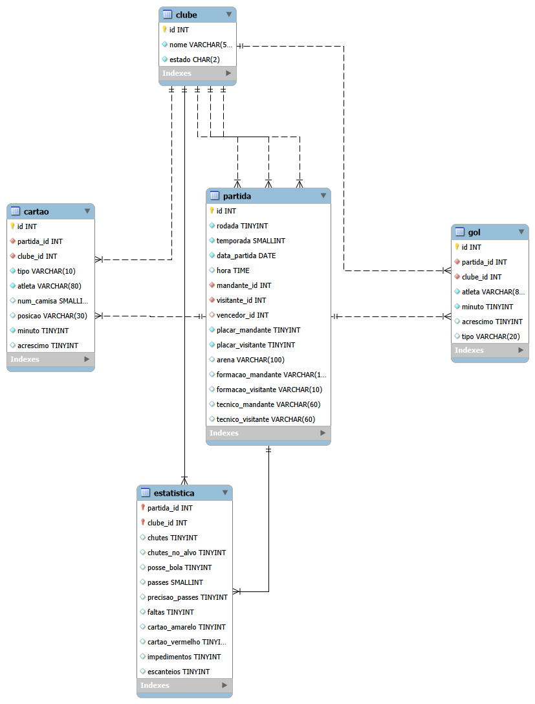

# Brasileirão em SQL (2003–2024)

Projeto de modelagem, ETL e análise de dados do Campeonato Brasileiro Série A em **MySQL 8**: dos CSVs brutos a um banco relacional validado, com consultas de análise e views.

## Dados

Fonte: [Brasileirao_Dataset](https://github.com/adaoduque/Brasileirao_Dataset), por Adão Duque. Os CSVs originais estão em `dados/`, sem alterações.

| Tabela | Registros | Período |
|---|---|---|
| `clube` | 45 | — |
| `partida` | 8.785 | 2003–2024 |
| `gol` | 9.861 | 2014–2024 |
| `cartao` | 20.953 | 2014–2024 |
| `estatistica` | 17.570 | 2003–2024 (dados reais a partir de 2014) |

## Modelo



- `partida` tem três chaves estrangeiras para `clube` (mandante, visitante e vencedor; vencedor `NULL` = empate).
- `estatistica` usa chave primária composta (`partida_id`, `clube_id`).
- `CHECK` garante que mandante ≠ visitante e que percentuais ficam entre 0 e 100.

## Como rodar

Pré-requisito: MySQL 8.0.16+ (para `CHECK`).

1. Copie os CSVs de `dados/` para a pasta indicada por `SHOW VARIABLES LIKE 'secure_file_priv';` e ajuste o caminho nos `LOAD DATA` de `02_carga.sql`, se for diferente.
2. Rode, nesta ordem:

| Arquivo | Função |
|---|---|
| `sql/01_schema.sql` | cria o banco e as 5 tabelas |
| `sql/02_carga.sql` | carrega os CSVs em tabelas staging e faz o ETL |
| `sql/05_validacao.sql` | confere a carga (valores esperados nos comentários) |
| `sql/03_consultas.sql` | consultas de análise |
| `sql/04_views.sql` | views |

`02_carga.sql` deve sempre rodar depois de `01_schema.sql`, que recria as tabelas.

## ETL e decisões de modelagem

- **Staging:** cada CSV é carregado em uma tabela só com `VARCHAR`; a conversão de tipos acontece no `INSERT ... SELECT`, onde cada regra fica explícita.
- **`temporada`:** coluna derivada da data. A temporada 2020 foi adiada pela pandemia e terminou em fevereiro de 2021, então `YEAR(data)` misturaria dois campeonatos.
- **Sem coluna de dia da semana:** é derivável da data (`DAYNAME`), então não foi armazenada.
- **Sem `rodada` em gol, cartão e estatística:** já está em `partida`.
- **Gol contra:** no dataset, o clube do gol contra é o **beneficiado**. Gols por clube batem com o placar; para artilharia, gols contra são excluídos.

## Qualidade dos dados

| Problema | Tratamento |
|---|---|
| Datas em `dd/mm/aaaa` | `STR_TO_DATE` |
| Empate marcado como `-` no vencedor | `LEFT JOIN` → `NULL` |
| Coluna `rodata` (erro de digitação) | renomeada para `rodada` |
| Strings vazias e texto `None` em vez de nulo | `NULLIF` → `NULL` |
| Minutos como `45+2` | separados em `minuto` e `acrescimo` |
| Percentuais com `%` | símbolo removido, convertido para inteiro |
| Espaço no início do nome de estádios | `TRIM` |
| Partida 1114 (Brasiliense 0 x 1 Vasco, 2005) marcada como empate | vencedor corrigido pelo placar |
| Estatísticas zeradas em 2003–2013 | convertidas para `NULL` |
| Chutes ausentes em 2014 e 2024 | mantidos; não usar chutes nesses anos |
| 2016 com 379 partidas | Chapecoense x Atlético-MG não disputada após a tragédia da Chapecoense |
| 9 camisas acima de 99 (ex.: 700, 123) | verificadas e mantidas (comemorativas, escolha do jogador, promoção Panini) |

**Validação** (`05_validacao.sql`): contagens de todas as tabelas, partidas por temporada, coerência entre vencedor e placar, e gols registrados × placar (0 divergências em 2014–2024). Os 22 campeões calculados batem com os campeões oficiais.

## Consultas e resultados

**1. Campeão de cada temporada** — `UNION ALL` (cada jogo visto pelos dois lados), `GROUP BY`, `ROW_NUMBER()` com critérios de desempate.
Os 22 campeões calculados coincidem com os oficiais.

**2. Maiores artilheiros (2014–2024)** — `RANK()` em subconsulta.
Gabriel Barbosa lidera com 101 gols. `RANK()` em vez de `LIMIT 10`: há 5 jogadores empatados com 56 gols no corte, e `LIMIT` descartaria 3 deles arbitrariamente.

**3. Vantagem do mandante por temporada** — `AVG()` sobre comparações.
Entre 2009 e 2018, o mandante venceu 47–53% das partidas; entre 2019 e 2024, 44–48%. Em 2020, disputado sem público, a taxa foi de 45,0%, abaixo de 2019 (48,4%), mas acima de 2017 (43,9%), quando havia torcida. Os dados indicam queda gradual da vantagem de jogar em casa; o ano sem público não se destaca da variação normal.

**4. Disciplina por clube (2014–2024)** — CTEs, agregação condicional, jogos contados por `partida` (inclui jogos sem cartão). Mais cartões por jogo: Coritiba (2,88), Juventude (2,87), Figueirense (2,84) e Vasco (2,83). Menos cartões por jogo: Corinthians (2,17), América-MG (2,20), Chapecoense (2,22) e Flamengo (2,23). A diferença entre o clube mais e o menos punido é de cerca de 0,7 cartão por jogo.

**5. Top 3 artilheiros de cada clube** — `RANK() OVER (PARTITION BY clube)`.

**6. Posse de bola × resultado (2014–2024)** — `CASE` em faixas.
Clubes com menos de 40% de posse venceram 42,8% dos jogos; com 60% ou mais, 29,6%. Posse alta não se traduziu em vitória. Uma explicação provável é a causalidade invertida: quem sai na frente tende a ceder a bola. Os dados mostram associação, não causa.

**7. Clássicos estaduais (20 clubes com mais jogos)** — subconsulta (top 20) + JOIN por estado + HAVING (mínimo de 30 clássicos).
Rival definido como clube do mesmo estado. Nenhum clube passa de 52,2% de aproveitamento contra rivais estaduais (Cruzeiro, em 46 jogos), o que confirma o equilíbrio dos clássicos. No outro extremo estão Ponte Preta (36,1%) e Fluminense (39,7%), único clube grande abaixo de 40%.

## Views

- `vw_classificacao`: tabela completa de cada temporada (posição, pontos, V/E/D, gols, saldo).
- `vw_artilharia`: gols por atleta, clube e temporada, já sem gols contra.

```sql
-- tabela de 2024
SELECT * FROM vw_classificacao WHERE temporada = 2024 ORDER BY posicao;

-- artilheiros do Flamengo em 2019
SELECT * FROM vw_artilharia
WHERE clube = 'Flamengo' AND temporada = 2019
ORDER BY gols DESC;
```

## Limitações

- Gols e cartões só existem a partir de 2014.
- Nomes de atletas não são padronizados (apelido × nome completo); totais de um mesmo jogador podem estar divididos.
- A classificação é calculada pelos resultados e não considera punições de tribunal (ex.: perda de pontos).
- "Rival" na consulta 7 é qualquer clube do mesmo estado, não só os clássicos tradicionais.

## Autor

Felipe Cavalcante Martins — [github.com/FelipeCMartins0](https://github.com/FelipeCMartins0)